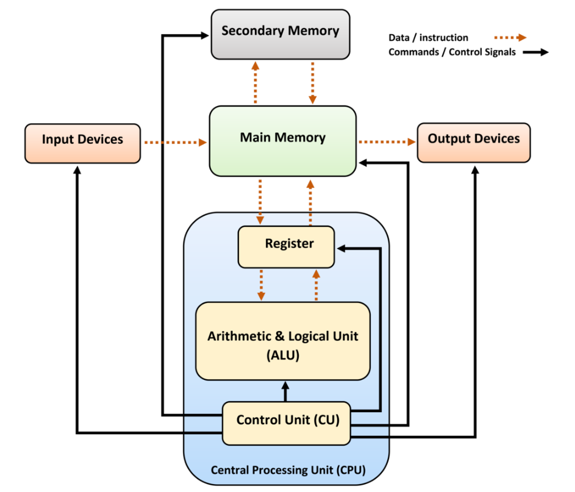

## Computer Architecture



Example: Type "A" and display it on screen

### 1. Translating "A" to binary

This happens on OS-level using device drive. In the example of input from keyboard:

Each key on the keyboard has a single, unique scan code, given in the table below.

https://www.millisecond.com/support/docs/current/html/language/scancodes.htm

These scan codes are numbers.

OS keyboard driver translates scan code → character code

```
Key press
 → scan code
 → character code (65)
 → stored as binary (01000001)
 ```

### 2. Control Unit load binary to RAM - Main Memory


