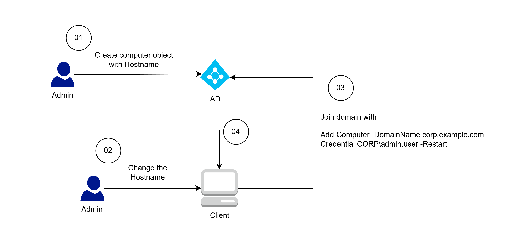
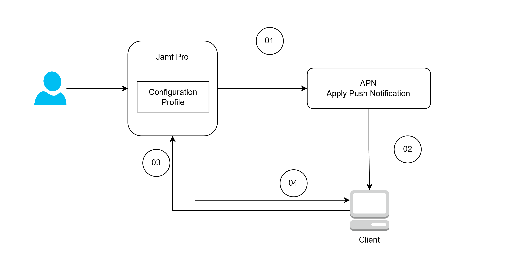

## Domain-join machine (for Window OS)

- Computer object created on Active Directory User Group, this will come with a **Hostname**.

- On brand-new computer:
1. SysAdmin open terminal
2. Input "Add-Computer -DomainName corp.example.com -Credential CORP\admin.user -Restart" (require SysAdmin credential with permission to add computer)
3. If AD already has the machine Hostname, the computer object will be applied respectively.
4. Restart machine
5. Machine join the domain

- After joining a Domain, machine receive the GPO, which enforce machine only accept a domain-join users.

## Domain-join machine (for MacOS)
- Mostly the same as above -> Domain user should be able to login with their credential now.

- However, MacOS cannot receive GPO from Active Directory --> Jamf as the MDM

### Domain-join process with Jamf:

1. Setup Jamf as MDM server with either:
    
    (1) - via manual configuration:
    - Download Jamf enrollment profile from Jamf Pro.
    - User installs the profile on Mac.

    (2) - via Zero Touch with Apple Business Manager:
    - Setup trust between Jamf Pro instance and ABM profile (including purchased devices)
    - In Jamf Pro, create a Pre-Stage enrollment configuration and apply to the connected ABM profile.
    - When user boot the MacOS, this will trigger a setup workflow and enroll devices to Jamf Pro inventory.

After enrolling to the MDM server/Jamf Pro, the MacOS machine receive:
- A MDM Enrollment Profile - an XML file ends with .mobileconfig, building trust between devices and Jamf Pro.
- Jamf agent - an agent used to execute script from Jamf Pro.

2. Push GPO-like policy / Configuration Profiles:

On Jamf Pro interface, create a Configuration Profile, which is GPO-like policy targetting all devices.

This will create a Configuration Profile - an XML file ends with .mobileconfig.

MacOS can apply configuration that are defined in the XML file.

